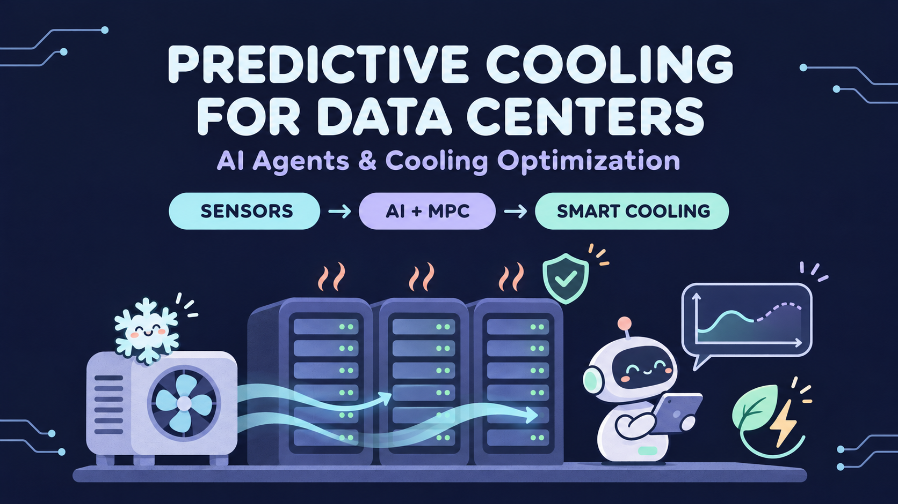
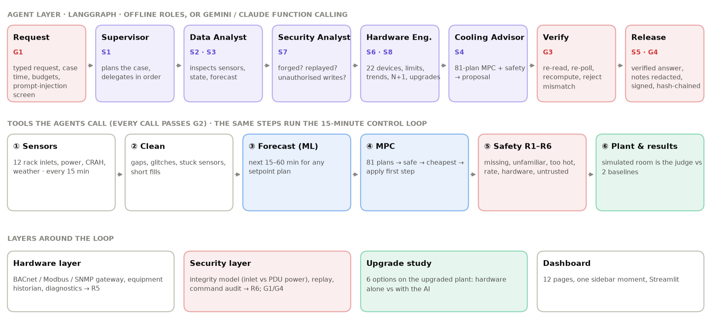
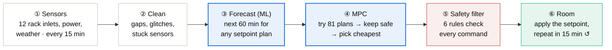
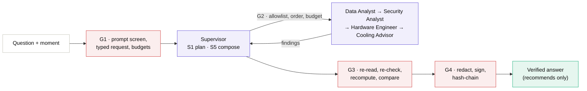
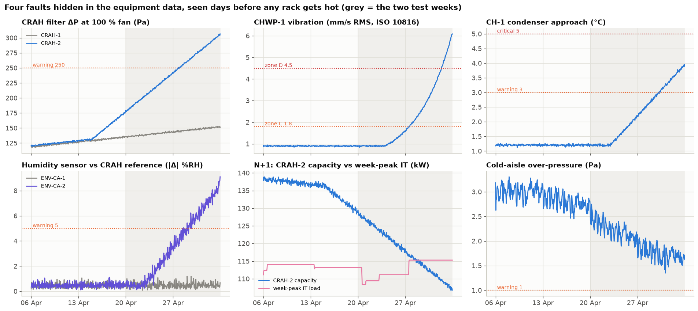
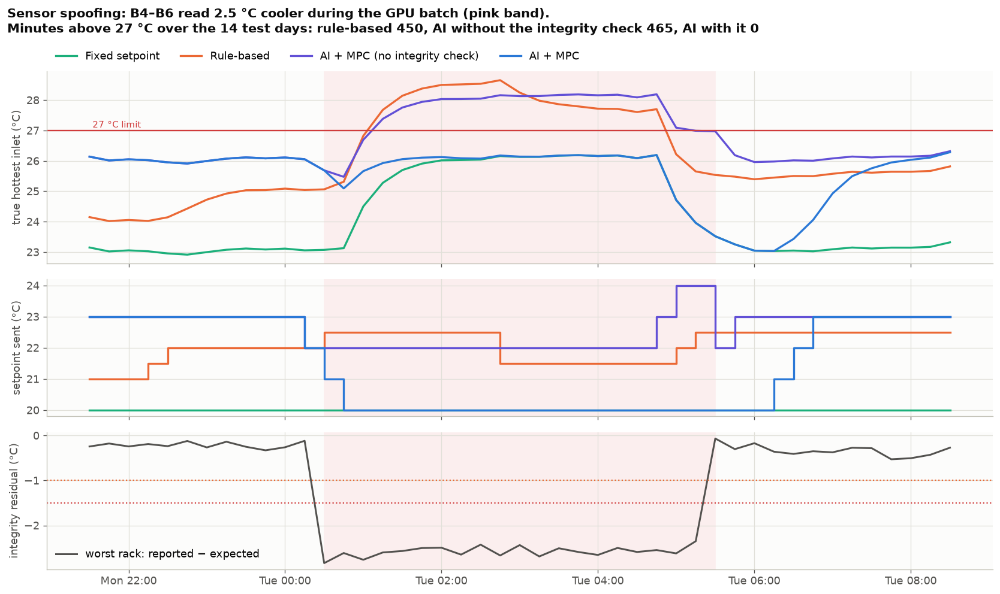
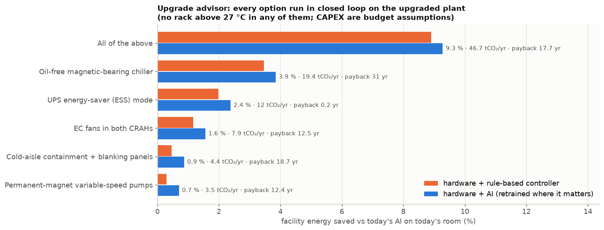

# Predictive Cooling Optimization for Data Centers


> **"If the load will rise in 30 minutes, how should we adjust the cooling right now so the racks stay below the limit and we use as little electricity as possible?"**

An **agent-based** predictive cooling system for a mock 12-rack server room. Every 15 minutes a machine-learning forecaster
and an 81-plan MPC pick the warmest supply-air setpoint that keeps every rack inlet at or below 27 °C, and six safety rules
can override them. **Five AI agents** answer an operator's questions through guarded Python tools, and **four guards**
(G1–G4) check everything they do. Around the loop:

- a **hardware layer** that reads 22 devices over BACnet/IP, Modbus TCP and SNMP v3 and spots equipment faults days early;
- a **security layer** that catches forged or replayed sensor data and prompt injection, and signs every answer;
- an **upgrade advisor** that tests each hardware option together with the AI and ranks them by payback;
- a **7-page Streamlit dashboard** that shows all of it.

## At a glance

Two test weeks the AI never trained on (20 Apr – 3 May 2026), scored by the simulated room:

| | Result |
|---|---|
| **Energy** | **2.1 % less cooling energy** than a tuned rule-based controller (5.0 % vs a fixed setpoint), **0 minutes** above 27 °C |
| **Safety** | B5/B6 sensors offline during the GPU batch: **0 minutes** above 27 °C (rule-based 210, the AI without its safety filter 240) |
| **Security** | Forged GPU-rack readings: **0 minutes** above 27 °C (the AI without the integrity check 465); replayed readings: **0** (390) |
| **Hardware** | A clogging filter, a worn pump bearing, a fouled condenser and a drifting sensor flagged **2–6 days** before their warning limit; 0 false alarms in the healthy weeks |
| **Upgrades** | All options together save **9.3 %** of facility energy (≈ 427k THB and 46.7 tCO₂ a year); the UPS energy-saver mode pays back in 0.2 years |

**Contents:** [Quick start](#quick-start) · [How it works](#how-it-works) · [Results](#results) ·
[Agents and guards](#agents-and-guards) · [Hardware](#hardware-layer) · [Security](#security-layer) ·
[Upgrades](#equipment-and-upgrades) · [Dashboard](#dashboard) · [Deploy](#deploy) · [Limitations](#limitations) ·
[Files](#files) · [Sources](#sources) · deeper detail in [architecture/](architecture/README.md)

## Quick start

Python 3.11+ (developed on 3.14, checked on a fresh 3.13). The versions in `requirements.txt` are pinned so the committed
study (`artifacts/bundle.pkl`) is reused; with a different scikit-learn the first start rebuilds it (2–5 minutes).

```bash
python3 -m venv .venv
.venv/bin/pip install -r requirements.txt
.venv/bin/python -m predictive_cooling
```

The last command opens the dashboard at http://localhost:8501.

| To | Run (from the project folder) |
|---|---|
| Print every result table | `.venv/bin/python -m predictive_cooling.pipeline` |
| Ask the agents | `.venv/bin/python -m predictive_cooling.agents --at "2026-04-21 00:30"`, optionally with `--mode analyze`/`upgrade`, `--fault B5 B6`, `--equipment-fault CRAH-1`, `--attack spoofing`/`replay`/`setpoint_tamper`, `--agent gemini`/`claude` |
| Rebuild the data | `.venv/bin/python -m predictive_cooling.dataset` and `-m predictive_cooling.hardware` (fixed seeds: identical files) |
| Redraw the figures | `.venv/bin/pip install -r requirements-dev.txt`, then `.venv/bin/python scripts/make_figures.py` |
| Run the tests | `.venv/bin/python -m pytest -q` (122 tests, about 2 minutes) |

## How it works



The same Python steps do two jobs. Every 15 minutes they **run the room** in closed loop, scored on the simulated plant.
On demand, the **agents call them as tools**, and the guards check each call and recompute the answer before release.
The hardware and security layers feed both, through safety rules R5 and R6.



Blue = machine learning, red = safety, green = what reaches the room.

| Step | Code | What it does |
|---|---|---|
| ① Sensors | `dataset.py` | Mock room log, 2 Feb – 3 May 2026, every 15 min: **8,718 rows × 25 columns** (`data/sensor_history.csv`). Weekday GPU batch 01:00–05:00 on racks B4–B6, setpoint step tests in the history (so the model can learn what the setpoint does), and faults added on purpose: 0.3 % missing, 85 / −40 / 0 °C glitches, a stuck sensor, two logger outages |
| ② Clean | `preprocess.py` | Back on the 15-min grid → impossible values and stuck sensors (6+ repeats) become missing → holes up to 1 h filled. Split by time, never shuffled: train weeks 1–9, validate 10–11, test 12–13 |
| ③ Forecast | `forecast.py` | Gradient boosting with physics monotonic constraints (warmer setpoint → warmer racks, less chiller power). Predicts the hottest inlet, cooling kW and IT kW 15–60 min ahead for any setpoint plan |
| ④ Plan | `mpc.py`, `controllers.py` | −1 / 0 / +1 °C per 15 min over one hour = 81 plans. Drops plans whose forecast + safety margin exceeds 27 °C (the margin is the 99th percentile of under-prediction on validation), keeps the cheapest, applies only its first step. The last forecast error is fed back into the next forecast |
| ⑤ Safety | `safety.py` | Rules R1–R6 (see [Agents and guards](#agents-and-guards)) can override the AI before anything is sent |
| ⑥ Room | `plant.py`, `evaluate.py` | A physics model is the judge: hot-air recirculation (B6 is always hottest), 25-min thermal lag, chiller COP +4 % per °C warmer, server fans speed up above 26 °C |

More: [data.md](architecture/data.md) (every column, the floor map), [control-loop.md](architecture/control-loop.md).

## Results

14 test days in closed loop. Each cell is cooling energy or minutes with a true rack inlet above 27 °C.

| | Fixed 20 °C | Rule-based (tuned) | **AI + MPC** |
|---|---|---|---|
| Cooling energy, normal operation | 12,512 kWh | 12,144 kWh | **11,892 kWh** |
| PUE | 1.489 | 1.477 | **1.471** |
| Minutes > 27 °C, normal operation | 0 | 0 | **0** |
| … B5/B6 sensors offline during the GPU batch | 0 | 210 | **0** (without the safety filter: 240) |
| … room changed after training (+20 % recirculation, chiller 10 % worse) | 1,980 | 150 | **60** |
| … unplanned load surge (+45–50 % on the GPU racks) | 0 | 0 | 15 (peak 27.03 °C) |

- **Forecast**: hottest-inlet error 0.17–0.18 °C from 15 to 60 minutes ahead (persistence 0.31–0.71, linear 0.19–0.34);
  cooling-power NRMSE 3.5 % at 60 minutes. Targets were ≤ 1 °C and ≤ 10 %.
- **Energy**: facility energy −0.40 % vs the rule (≈ 18,500 THB a year at 4 THB/kWh), −1.22 % vs fixed. A decision takes 24 ms.
- **Safety**: without the filter, the AI trusts the cooler remaining sensors and overheats the room. After a room change the
  feedback correction cuts overheating from 240 to 60 minutes, which is the signal to retrain.


> **An honest reading:** the proposal targeted ≥ 10 % cooling savings vs a tuned rule; this room gives **2.1 %**. Rack B6 is a
> permanent hot spot, server fans speed up above 26 °C (so warmer is not always cheaper), and the setpoint is the only knob.
> Airflow fixes at B6 or more knobs (chilled-water temperature, fan speed) are the next lever; see [Upgrades](#equipment-and-upgrades).

## Agents and guards



The agents decide **what to check and in which order**, and explain. They cannot compute numbers themselves, change the
27 °C limit, call tools outside their skill, or touch equipment.

| Agent | Skills | Tools (allowlist enforced by G2) |
|---|---|---|
| Supervisor | S1 Plan the case, S5 Compose the answer | `call_data_analyst`, `call_security_analyst`, `call_hardware_engineer`, `call_cooling_advisor`, `finish_case` |
| Data Analyst | S2 Inspect sensor data, S3 Analyze & forecast | `read_sensors`, `inspect_data_quality`, `summarize_state`, `forecast_hold` |
| Security Analyst | S7 Verify data integrity | `check_sensor_integrity`, `audit_command_channel` |
| Hardware Engineer | S6 Inspect equipment, S8 Plan upgrades | `read_equipment`, `diagnose_equipment`, `evaluate_upgrades` |
| Cooling Advisor | S4 Evaluate setpoint plans | `run_mpc`, `check_safety`, `propose_setpoint` |

| Guard | When | Checks |
|---|---|---|
| G1 | Before the agents | Prompt-injection screen (block or withhold), typed request (15-min grid, known racks and devices), case time inside the logs, budgets |
| G2 | Every tool call | Skill owner and allowlist, order (no MPC before inspection), shared tool / model budget and deadline; tools only see data **at or before** the case time |
| G3 | Before release | Re-reads sensors, re-checks integrity, re-polls equipment, recomputes forecast + MPC + safety. A proposal that differs is rejected (`PROPOSAL_EVIDENCE_MISMATCH`) |
| G4 | On release | Redacts keys, links and e-mails from model notes; HMAC-signs the answer (15-min expiry, one-time nonce); seals the trace in a SHA-256 hash chain |

| Safety rule | When | Then |
|---|---|---|
| R1 Missing data | A rack inlet sensor is missing | Head to the proven fallback setpoint (20 °C), 1 °C per step |
| R2 Unfamiliar | Inputs far outside the training data | Fallback setpoint |
| R3 Too hot now | Hottest inlet within 0.3 °C of 27 °C | Cool by 2 °C at once |
| R4 Limits | Always | At most ±1 °C per 15 min, within 16–24 °C |
| R5 Hardware | The Hardware Engineer reports a cooling-path problem | `no_raise`: never warmer than now; `fallback`: nor warmer than the fallback |
| R6 Untrusted | Forged or replayed data, or an unauthorised setpoint write | Never warmer than now or than the fallback |

**Modes.** *Offline* (default): fixed role procedures in LangGraph, no LLM, deterministic. *Gemini* (`GEMINI_API_KEY`) and
*Claude Haiku 5.5* (`ANTHROPIC_API_KEY`): real parent/child function calling, one tool per turn, failing closed on missing
keys, refusals or cut-off answers. A *recommend* case takes 19 model calls; live modes allow 5 cases per 10 minutes per
session and 40 per hour per app. The last live Gemini run (11 calls, 36.8 s, same answer as offline) predates the Security
Analyst and Hardware Engineer; the five-agent loops are tested with scripted providers and a mock Claude server.

**Example** (21 Apr 00:30): holding 22 °C would reach 27.5 °C (with margin) when the 01:00 GPU batch starts. 18 of 81 plans
are safe, the readings pass the integrity check, all 22 devices are healthy, G3 passes 9 of 9 checks, and the signed answer
is "Change from 22 °C to 21 °C now". At 29 Apr 05:30 the MPC wants 21 °C, but lost N+1 capacity and a worn pump bearing make
R5 keep 20 °C. More cases and the budgets: [agents.md](architecture/agents.md), [guardrails.md](architecture/guardrails.md).


## Hardware layer

`predictive_cooling/hardware/` reads what the devices report themselves: `data/equipment_telemetry.csv`, **22 devices and
69 points** every 15 minutes, from the same plant run as the room log.

- **Devices**: 2 CRAH units (BACnet/IP); the chiller, duty and standby pumps, cooling tower and 3 room sensors (Modbus TCP);
  the UPS and 12 rack PDUs (SNMP v3).
- **Sensor gateway**: decodes each protocol's encoding with a point map and flags `out_of_range`, `no_data` and `comm_loss`.
  It is read-only, and a real BACnet/Modbus/SNMP client can replace the simulated bus behind the same `read()`.
- **Diagnostics**: limits with sources (ISO 10816-1 vibration, ASHRAE humidity, filter ΔP, condenser approach), a 7-day trend
  → days until the next limit, and an N+1 check. A drifting humidity sensor is caught against the CRAH dew point.
- **Rule R5**: a cooling-path warning means *never warmer than now*; a failure with no backup (a tripped CRAH) also means *no
  warmer than the fallback*. Advisory findings (UPS, humidity, sensor drift) do not constrain cooling.

| Fault hidden in the test weeks (starts) | First flagged | Warning | Critical |
|---|---|---|---|
| CRAH-2 filter loading (15 Apr) | 21 Apr | 27 Apr 19:00, N+1 lost 27 Apr 18:00 | – |
| CHWP-1 bearing wear (24 Apr) | 25 Apr | 27 Apr 15:00 (ISO zone C) | 2 May 09:00 (zone D) |
| ENV-CA-2 humidity drift (22 Apr) | 25 Apr | 28 Apr 04:00 | – |
| CH-1 condenser fouling (23 Apr) | 25 Apr | 30 Apr 01:00 | – |
| CT-1 not answering (26 Apr 14:00–16:00) | – | 26 Apr 14:00 | – |



The protocol and point map of every device: [hardware.md](architecture/hardware.md).

## Security layer

BACnet/IP and Modbus TCP have **no authentication**: anyone on that network can forge a reading, replay a recording or write
a setpoint. The dangerous lie is a rack reported *cooler* than it is, which makes an AI (or a rule) run the room warmer.

| Defence | How |
|---|---|
| **Integrity model (ML)** | Per rack: inlet predicted from supply air and that rack's PDU power (residual 0.18 °C). Flagged when > 1.5 °C cooler once or > 1.0 °C twice in a row; 0 false alarms on 2,682 readings. The PDUs are on a separate SNMP v3 network, so an attacker must forge two systems |
| **Replay detection** | Twelve noisy inlets never repeat exactly; a reading vector equal to one from the last day is a recording |
| **Command audit** | Each CRAH's setpoint must equal what was commanded; a difference is an unauthorised write |
| **Rule R6** | Untrusted data → the AI is withheld and the room gets no warmer, in the control loop and in every agent case |
| **G1 / G4** | Prompt-injection screen (normalised text, weighted patterns, block or withhold); redaction of secrets, links and e-mails |
| **Signing, trace, rate limit** | HMAC-SHA256 answers with expiry and one-time nonce; SHA-256 hash-chained trace; paid modes rate-limited |

| Attack on the nightly GPU batch (14 test days) | Fixed | Rule-based | AI *without* the check | **AI + MPC** |
|---|---|---|---|---|
| **Spoofing**: B4–B6 read 2.5 °C cooler (21 and 28 Apr) | 0 | 450 | 465 (peak 28.21 °C) | **0** |
| **Replay**: old nights played back (27 and 30 Apr) | 0 | 435 | 390 (peak 29.21 °C) | **0** |



Minutes with a true inlet above 27 °C. The check never fires in the non-attack scenarios, so every other result is
identical with it on. Not covered: forgeries smaller than about 1 °C, and an attacker who controls both networks.
Threat model (STRIDE) and protocols: [security.md](architecture/security.md).

## Equipment and upgrades

**Installed** (`hardware/catalog.py`, vendor facts checked Nov 2026): Eaton 93PM UPS, Raritan PX3 rack PDUs, APC NetBotz
temperature/humidity sensors, Setra 264 pressure sensor, Schneider PowerLogic PM5560 meters, Siemens SITRANS MAG 5100 W flow
meter and ifm VKV021 vibration sensor. The legacy CRAH units and chiller are described by class. **Flows**
(`hardware/flows.py`): where the electricity goes (grid → UPS → racks and cooling) and where the heat goes (racks → chilled
water → chiller → cooling tower → outdoors); both balance exactly.

**Upgrade study** (`hardware/upgrades.py`, `advisor.py`): each option changes the plant model conservatively and runs the
two test weeks with the hardware alone and **with the AI**, retrained on the upgraded room when its behaviour changes.
Facility energy saved vs today (1,151 MWh/yr, PUE 1.471), annualised:

| Option (example products) | Hardware alone | **With the AI** | THB/yr | tCO₂/yr | CAPEX (assumed) | Payback |
|---|---|---|---|---|---|---|
| UPS energy-saver mode (Eaton 93PM ESS) | 1.98 % | **2.38 %** | 109,537 | 12.0 | 0.03 M THB | **0.2 yr** |
| Variable-speed pumps (Grundfos TPE3) | 0.30 % | **0.70 %** | 32,360 | 3.5 | 0.40 M | 12.4 yr |
| EC fans in both CRAHs (ebm-papst, or Liebert PCW) | 1.16 % | **1.56 %** | 71,984 | 7.9 | 0.90 M | 12.5 yr |
| Cold-aisle containment (Vertiv SmartAisle or similar) | 0.46 % | **0.87 %** | 40,203 | 4.4 | 0.75 M | 18.7 yr |
| Oil-free magnetic-bearing chiller (Danfoss Turbocor) | 3.46 % | **3.85 %** | 177,279 | 19.4 | 5.50 M | 31 yr |
| All of the above | 8.91 % | **9.28 %** | 427,246 | 46.7 | 7.58 M | 17.7 yr |



No option let a rack exceed 27 °C. CO₂ uses Thailand's grid factor (0.4371 tCO₂/MWh, TGO 2022), electricity 4 THB/kWh;
CAPEX values are budget assumptions (editable on the dashboard), not quotes. What it says: switch the UPS to ESS first (after
a risk review), fix the filter and bearing before buying anything, and replace the chiller only at end of life. With
containment the AI sits at the 24 °C ceiling 88 % of the time, so the site's setpoint policy becomes the limit.
Details: [upgrades.md](architecture/upgrades.md).

## Dashboard

Seven pages in a top menu. The **moment** in the sidebar (any 15 minutes of the test weeks, with *Jump to* shortcuts) drives
every page. Each page shows a few key numbers and one main chart; everything else is folded away under *More detail*.

| Page | What you do there |
|---|---|
| **Overview** | See the headline numbers and where to go next |
| **Ask the agents** | Pick a task, press *Run case*, read the verified answer; options let you choose the AI model or simulate failed sensors, an equipment trip or a cyber attack |
| **Results** | Compare the three controllers in each scenario |
| **Data center** | See the plant live (hover for each unit's model), its health and what needs action; trip a unit to test |
| **Security** | Pick an attack and see what the integrity check prevents; test the prompt screen |
| **Upgrades** | See which upgrade pays back fastest and which saves most; enter your own prices |
| **How it works** | Follow the loop one step at a time: sensors, cleaning, forecast (with a what-if), the 81 plans, safety |

Page layout and tests: [dashboard.md](architecture/dashboard.md).

## Deploy

One Streamlit service (LangGraph runs inside it). On [Streamlit Community Cloud](https://share.streamlit.io): repo, branch
`claude-new-version`, main file `app.py`, Python 3.12. `artifacts/bundle.pkl` is committed, so it starts without retraining.
Every secret is optional (template: `.streamlit/secrets.toml.example`; locally, `.streamlit/secrets.toml` is git-ignored):

| Secret | Turns on |
|---|---|
| `GEMINI_API_KEY` (+ `GEMINI_MODEL`, e.g. `gemini-3.5-flash-lite` on a free key) | The Gemini agent mode |
| `ANTHROPIC_API_KEY` | The Claude Haiku 5.5 agent mode (billed per token) |
| `SUPABASE_URL`, `SUPABASE_KEY` (server-side key) | Case history; run `supabase/migrations/001`–`003` in order first |
| `COMMAND_SIGNING_KEY` | A signing key that survives restarts (otherwise a new one per process) |

Step by step: [deployment.md](architecture/deployment.md).

## Limitations

- All data is **mock** data from a simple physics model. The numbers show *the method*, not guaranteed savings at a real site.
- The model and the plant were designed by the same person; the next test is another simulator (e.g. SustainDC) or real data.
- Nothing here controls real equipment. The system only recommends, in a simulated room.
- The security checks are tested against the simulated attacks here, not a red team. Pattern-based prompt screening can be
  evaded by rephrasing; the numbers stay safe because Python computes them and G3 re-checks them.

More: [review.md](architecture/review.md).

## Files

```
app.py, app_pages/, ui/      dashboard: entry and menu, one file per page, shared helpers (plant drawing, loop steps, art)
predictive_cooling/          the loop: dataset, preprocess, forecast, mpc, safety, controllers, plant, evaluate, pipeline
  hardware/                  device registry, sensor gateway, historian, diagnostics, catalog, flows, upgrades, advisor
  security/                  integrity model, command audit, attacks, prompt guard, signing, audit chain, rate limit
  agents/                    LangGraph engine (G1–G4), tools, LLM loops, Gemini/Claude providers, skills S1–S8
data/                        sensor_history.csv (room log), equipment_telemetry.csv (device historian)
artifacts/bundle.pkl         trained models and every closed-loop run (committed for deployment)
tests/                       pipeline, hardware, security, upgrades, agents, storage, dashboard (headless)
architecture/                one document per component
docs/, scripts/              README figures and the script that draws them
supabase/migrations/         SQL for the optional case history
Midterm Project /            proposal report (PDF)
```

Branches: `main` is the earlier SustainDC/FastAPI agent prototype, `claude` the pipeline-only redesign, and
`claude-new-version` this version.

## Sources

Facts about named products are the vendors' published figures (checked Nov 2026); the simulation does not use them
directly. Upgrade effects are modelled conservatively against them and measured in closed loop.

- Thailand grid emission factor 0.4371 tCO₂/MWh (2022): [TGO grid emission factor table](https://ghgreduction.tgo.or.th/en/download/download/13065/3377/32.html) · [TGO update, Nov 2025](https://www.nationthailand.com/news/policy/40059019)
- Installed: [Eaton 93PM datasheet](https://www.eaton.com/content/dam/eaton/products/backup-power-ups-surge-it-power-distribution/backup-power-ups/eaton-93pm-ups/eaton-93pm-ups-30-250kva-datasheet-ps153029en.pdf) · [Raritan PX3 tech specs](https://review.raritan.com/products/power/power-distribution/rack-pdu/tech-specs) · [NetBotz AP9335TH (manual)](https://www.manualsdir.com/manuals/42152/apc-netbotz-nbrk0200.html?page=28) · [NetBotz sensor accuracy](https://community.se.com/t5/EcoStruxure-IT-forum/Netbotz-sensors-accuracy/td-p/208583) · [Setra Model 264](https://www.setra.com/products/pressure/model-264-low-differential-pressure-transducer) · [PowerLogic PM5560](https://www.se.com/au/en/product/METSEPM5560/power-meter-powerlogic-pm5560-2-ethernet-up-to-63th-harmonic-11mb-4di-2do-52-alarms) · [SITRANS F M MAG 5100 W](https://www.siemens.com/global/en/products/automation/process-instrumentation/flow-measurement/electromagnetic/sitrans-f-m-mag-5100-w-for-water-applications.html) · [ifm VKV021](https://www.ifm.com/us/en/product/VKV021)
- Upgrades: [Vertiv SmartAisle](https://www.vertiv.com/en-us/products-catalog/facilities-enclosures-and-racks/integrated-solutions/smartaisle/) · [ebm-papst fan retrofit](https://www.ebmpapst.com/sg/en/ec-fan-solutions/fan-retrofit.html) · [Vertiv Liebert PCW](https://www.vertiv.com/en-us/products-catalog/thermal-management/room-cooling/vertiv-liebert--pcw-chilled-water-floor-mount-cooling-unit/) · [Danfoss Turbocor](https://danfoss.com/en/products/compressors/dcs/turbocor) · [Grundfos TPE3](https://product-selection.grundfos.com/products/tp-tpe/tpe3-i)
- Limits used by the diagnostics: ISO 10816-1 vibration zones (class I machines), ASHRAE TC 9.9 thermal guidelines (inlet ≤ 27 °C; humidity ≤ 60 %RH recommended, ≤ 80 %RH allowable A1)
