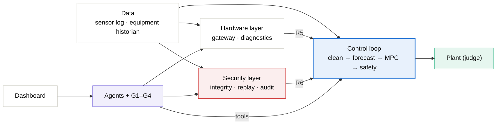

# Architecture

Component documents for the predictive-cooling project. Start with the [project README](../README.md) for the results and
how to run it; read these for how each part works and why.

| Document | What it covers | Main code |
|---|---|---|
| [overview.md](overview.md) | Goals, boundaries, the two layers, what is simulated | `predictive_cooling/` |
| [data.md](data.md) | The sensor log, the equipment historian, injected faults, cleaning, the time split | `dataset.py`, `preprocess.py`, `hardware/telemetry.py` |
| [control-loop.md](control-loop.md) | Forecaster, 81-plan MPC, controllers, the plant as judge, results | `forecast.py`, `mpc.py`, `controllers.py`, `plant.py`, `evaluate.py` |
| [agents.md](agents.md) | Five agents, skills S1–S8, tools, the three LLM modes, budgets | `agents/` |
| [guardrails.md](guardrails.md) | Guards G1–G4, safety rules R1–R6, every failure code | `agents/engine.py`, `safety.py` |
| [hardware.md](hardware.md) | 22 devices, sensor gateway, diagnostics, cooling constraint, installed models | `hardware/` |
| [security.md](security.md) | Threat model, integrity model, replay, command audit, prompt screen, signing, audit chain | `security/` |
| [upgrades.md](upgrades.md) | Flows, upgrade options, the physical + AI study, the advisor | `hardware/flows.py`, `hardware/upgrades.py`, `hardware/advisor.py` |
| [dashboard.md](dashboard.md) | The 7 pages, the shared moment, page structure, performance | `app.py`, `app_pages/`, `ui/` |
| [deployment.md](deployment.md) | Local run, Streamlit Cloud, secrets, Supabase, tests, regeneration | `.streamlit/`, `supabase/`, `tests/` |
| [review.md](review.md) | Known limits, what was not tested, next steps | — |

