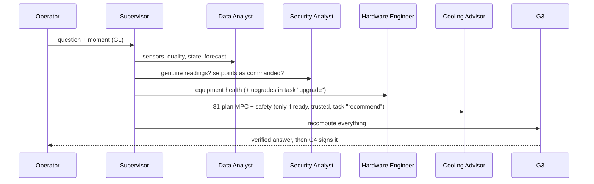

# Agents and skills

[Architecture index](README.md) · [Guardrails](guardrails.md)

| Role | Skills | Tools (G2 allowlist) |
|---|---|---|
| Supervisor (parent) | S1 Plan, S5 Compose | `call_data_analyst`, `call_security_analyst`, `call_hardware_engineer`, `call_cooling_advisor`, `finish_case` |
| Data Analyst | S2 Inspect, S3 Analyze & forecast | `read_sensors`, `inspect_data_quality`, `summarize_state`, `forecast_hold`, `finish_analysis` |
| Security Analyst | S7 Verify data integrity | `check_sensor_integrity`, `audit_command_channel`, `finish_security_review` |
| Hardware Engineer | S6 Inspect equipment, S8 Plan upgrades | `read_equipment`, `diagnose_equipment`, `evaluate_upgrades` (task `upgrade` only), `finish_equipment_check` |
| Cooling Advisor | S4 Evaluate plans | `run_mpc`, `check_safety`, `propose_setpoint` |

A skill is a versioned instruction file (`agents/skill_specs/s1…s8.md`, v0.5.0) bound to an owner and a tool list in
`agents/skills.py`. Loading a skill never adds tools; every load is traced with the file's SHA-256.

## Flow of one case

| Task | Agents | Decision | Model calls (live modes) |
|---|---|---|---|
| `recommend` | all five | `change` / `no_change` / `max_cooling` / `fallback` | 19 |
| `analyze` | all but the Cooling Advisor | `analysis_only` | 15 |
| `upgrade` | all but the Cooling Advisor; Hardware Engineer adds S8 | `upgrade_plan` | 16 |

## Modes

- **Offline** (default): LangGraph nodes run each role's fixed procedure. No LLM, deterministic, instant.
- **Gemini** (`GEMINI_API_KEY`, `GEMINI_MODEL`, default `gemini-3.5-flash-lite`) and **Claude** (`ANTHROPIC_API_KEY`,
  Claude Haiku 5.5): real parent/child function calling in `llm_loops.py`. Separate histories, exactly one tool call per turn,
  phase-limited tool lists, Pydantic-validated arguments, one shared tool / model budget and deadline. The operator question is
  passed as untrusted context (or withheld when G1 flags it). Missing keys, refusals and truncated answers fail closed.

Budgets (`Policy`): 30 tool calls, 24 model calls, 120 s offline / 300 s live, 5 live cases per 10 min per session and 40 per
hour per app. Live modes are tested with scripted providers and a mock Claude server; the last live Gemini run predates the
Security Analyst and Hardware Engineer.
