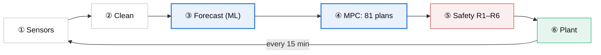

# Control loop and results

[Architecture index](README.md)

| Step | Code | How |
|---|---|---|
| ③ Forecast | `forecast.py` | Gradient boosting with physics monotonic constraints, one model per target (hottest inlet, cooling kW, IT kW) × horizon (15–60 min); inputs: current state + the setpoint plan. Compared with persistence and linear regression |
| ④ MPC | `mpc.py` | Each 15-min step −1 / 0 / +1 °C → 3⁴ = 81 plans; reject plans whose forecast + safety margin (99th percentile of under-prediction on validation) exceeds 27 °C; pick the lowest energy + a small move cost; apply only the first step |
| Feedback | `controllers.py` | The last forecast error is carried into the next forecast (bias, clipped to −0.5…+2 °C) |
| ⑤ Safety | `safety.py` | Rules R1–R6, see [guardrails.md](guardrails.md) |
| ⑥ Plant | `plant.py`, `evaluate.py` | Grey-box room: recirculation (B6 hottest), 25-min thermal lag, chiller COP +4 %/°C warmer supply air, server fans speed up above 26 °C inlet |

## Results (two test weeks, normal operation)

| | Fixed 20 °C | Rule-based (tuned) | AI + MPC |
|---|---|---|---|
| Cooling energy | 12,512 kWh | 12,144 kWh | **11,892 kWh** |
| Minutes > 27 °C | 0 | 0 | **0** |
| PUE | 1.489 | 1.477 | **1.471** |

Forecast MAE of the hottest inlet: 0.17 °C at 15 min, 0.18 °C at 60 min (persistence 0.31 / 0.71). Baselines were tuned on
the validation weeks. Fault and attack scenarios: sensor failure (AI 0 min, rule 210, AI without safety 240), room changed
after training (AI 60, rule 150, fixed 1,980), unplanned surge (AI 15), sensor spoofing and replay (AI 0, see
[security.md](security.md)). Every closed-loop number is stored in `artifacts/bundle.pkl` (`python -m predictive_cooling.pipeline`).

Why only 2.1 % against a tuned rule (target was 10 %): B6 is a permanent hot spot, server fans speed up above 26 °C, and the
setpoint is the only knob. [upgrades.md](upgrades.md) measures the hardware levers.
