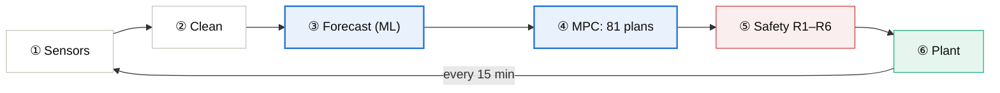

# Control loop and results

[Architecture index](README.md)

| Step | Code | How |
|---|---|---|
| ③ Forecast | `forecast.py` | Gradient boosting with physics monotonic constraints, one model per target (hottest inlet, cooling kW, IT kW) × horizon (15–60 min); inputs: current state + the setpoint plan. Compared with persistence and linear regression |
| ④ MPC | `mpc.py` | Each 15-min step −1 / 0 / +1 °C → 3⁴ = 81 plans; reject plans whose forecast + safety margin (99th percentile of under-prediction on validation) exceeds 27 °C; pick the lowest energy + a small move cost; apply only the first step |
| Feedback | `controllers.py` | The last forecast error is carried into the next forecast (bias, clipped to −0.5…+2 °C) |
| ⑤ Safety | `safety.py` | Rules R1–R6, see [guardrails.md](guardrails.md) |
| ⑥ Plant | `plant.py`, `evaluate.py` | Grey-box room: recirculation (B6 hottest), 25-min thermal lag, chiller COP +4 %/°C warmer supply air, server fans speed up above 26 °C inlet |

## Results (two test weeks the model never saw)

Forecast accuracy (hottest inlet MAE, °C; cooling-power NRMSE at 60 min):

| Model | Inlet MAE 15 min | 30 min | 45 min | 60 min | Cooling NRMSE 60 min |
|---|---|---|---|---|---|
| Persistence (no AI) | 0.31 °C | 0.48 | 0.61 | 0.71 | 10.0 % |
| Linear regression | 0.19 °C | 0.25 | 0.30 | 0.34 | 7.0 % |
| **Gradient boosting** | **0.17 °C** | **0.17** | **0.18** | **0.18** | **3.5 %** |

The ML model learned that the GPU batch starts at 01:00 on weekdays, so it sees it coming; persistence only notices once
it has started.

Example at 21 Apr 00:30, just before the batch: 18 of the 81 plans are safe; the cheapest, 21 → 21 → 21 → 22 °C, pre-cools
by 1 °C first.

Controllers compared, normal operation, 14 days:

| | Fixed 20 °C | Rule-based (tuned) | **AI + MPC** |
|---|---|---|---|
| Cooling energy | 12,512 kWh | 12,144 kWh | **11,892 kWh** |
| Facility energy (incl. the 0.2 kW AI server running 24/7) | 44,687 kWh | 44,319 kWh | **44,141 kWh** |
| PUE | 1.489 | 1.477 | **1.471** |
| Minutes with inlet > 27 °C | 0 | 0 | **0** |
| Average setpoint | 20.0 °C | 21.4 °C | 22.4 °C |
| Decision time per step | – | – | 24 ms (target < 10 s) |

The AI cuts cooling energy by 5.0 % vs the fixed setpoint and 2.1 % vs the tuned rule; whole-building energy drops by 1.22 % /
0.40 % (about 57,000 / 18,500 THB a year at 4 THB/kWh), with no overheating.

Fault tests (minutes with a true inlet above 27 °C):

| Scenario | Fixed | Rule-based | AI + MPC | AI without safety filter |
|---|---|---|---|---|
| Normal | 0 | 0 | 0 | – |
| **B5/B6 sensors go offline** during the GPU batch | 0 | 210 | **0** (28 fallback steps) | 240 |
| **Room changed after training** (+20 % recirculation, chiller 10 % worse) | 1,980 | 150 | **60** | – |
| **Unplanned load surge** (+45–50 % on the GPU racks) | 0 | 0 | 15 (peak 27.03 °C) | – |

- The safety filter matters: without it, the AI trusts the remaining (cooler) sensors and lets the room overheat for 240 minutes.
- When the room changes, feedback correction cuts overheating from 240 to 60 minutes, but short exceedances remain when the batch starts. That is a signal to retrain.
- Nobody can forecast a job that has never happened before. The AI runs closer to the limit, so it is hit harder in the first 15 minutes; then R3 cools by 2 °C immediately.

Attack scenarios: see [security.md](security.md). Every closed-loop number is stored in `artifacts/bundle.pkl`
(`python -m predictive_cooling.pipeline`).

Why only 2.1 % against a tuned rule (target was 10 %): B6 is a permanent hot spot, server fans speed up above 26 °C, and the
setpoint is the only knob. [upgrades.md](upgrades.md) measures the hardware levers.
