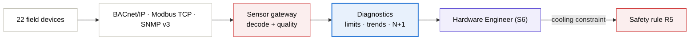

# Hardware layer

[Architecture index](README.md)

| Part | Code | What it does |
|---|---|---|
| Registry | `hardware/registry.py` | 2 CRAH (BACnet/IP), chiller, duty + standby pumps, cooling tower, 3 room sensors (Modbus TCP), UPS (SNMP v3, RFC 1628 UPS-MIB), 12 rack PDUs (SNMP v3). Each point: address, encoding, scale, valid range |
| Gateway | `hardware/gateway.py` | Encodes values the way each protocol carries them, decodes with the point map, flags `out_of_range` (impossible or saturated), `no_data`, `comm_loss`. Read-only. A real BACnet/Modbus/SNMP client can replace `SimulatedFieldBus` behind the same `read()` |
| Diagnostics | `hardware/diagnostics.py` | Limits with sources (ISO 10816-1 vibration, ASHRAE humidity, filter final ΔP, condenser approach, containment pressure, UPS); straight-line trend of daily means → days to the next limit (only when r² ≥ 0.8); N+1: one CRAH must carry the week's peak IT load; humidity sensors cross-checked against the CRAH return-air dew point |
| Constraint | same | Advisory → `none`; cooling-path warning → `no_raise`; cooling-path failure with no healthy backup → `fallback` (a critical pump with a ready standby stays `no_raise`) |
| Catalog | `hardware/catalog.py` | Installed model of every device and instrument with the vendor facts used and their source (see the README's Sources) |

Faults in the test weeks are flagged 2–6 days before their warning limit (filter, bearing, condenser, humidity drift);
checked every 6 hours from 9 Feb to 14 Apr, the healthy weeks raise no alarm. Example: at 29 Apr 05:30 the MPC wants 21 °C
after the GPU batch, the Hardware Engineer reports lost N+1 and a worn bearing, and R5 keeps 20 °C.

## Devices and protocols

| Device | Protocol | Points (examples) |
|---|---|---|
| CRAH-1, CRAH-2 | BACnet/IP (REAL values) | status, setpoint, supply/return air, return RH, fan speed/kW, airflow, filter ΔP, chilled-water valve |
| CH-1 chiller | Modbus TCP (16-bit registers × scale) | load, kW, COP, chilled-water supply/return, condenser in/out, condenser approach |
| CHWP-1 (duty), CHWP-2 (standby) | Modbus TCP via the drive | status, speed, flow, kW, vibration (mm/s RMS), bearing temperature |
| CT-1 cooling tower | Modbus TCP | fan speed, kW, wet bulb, cold-water temperature, approach |
| UPS-1 | SNMP v3, RFC 1628 UPS-MIB | output source, load %, output kW, battery temperature, efficiency |
| ENV-CA-1/2, ENV-DP-1 | Modbus TCP | cold-aisle temperature + RH (row A / row B side), containment over-pressure |
| PDU-A1 … PDU-B6 | SNMP v3 | power per rack |

## Installed models (vendor facts used; see `hardware/catalog.py` for sources)

| Where | Installed | Facts used |
|---|---|---|
| CRAH-1/2 | Legacy chilled-water CRAH, AC belt-driven fans (class) | 140 kW sensible, 34,000 m³/h each (site model) |
| CH-1 | Fixed-speed water-cooled screw chiller, 250 kW (class) | COP 3.6 at reference (site model) |
| UPS-1 | Eaton 93PM 200 kVA | up to 97 % double conversion, > 99 % in ESS mode |
| Rack PDUs ×12 | Raritan PX3 | ±1 % billing-grade metering, SNMPv3 |
| Rack inlets ×12 / cold aisle | APC NetBotz AP9335T / AP9335TH | ±2 °C; ±4 %RH (20–90 %RH at 25 °C) |
| Containment ΔP | Setra Model 264, 0–0.1 in. W.C. | ±1 % FS (listed as discontinued: plan a replacement) |
| Sub-meters | Schneider PowerLogic PM5560 | Class 0.2S, Modbus TCP + BACnet/IP |
| Chilled-water flow | Siemens SITRANS F M MAG 5100 W + MAG 5000 | ±0.4 % of rate |
| Pump vibration | ifm VKV021 | 0–25 mm/s RMS, 4–20 mA, to DIN ISO 10816 |

## Fault timeline (first appearance, checked hourly)

| Fault (starts) | Watch | Warning | Critical |
|---|---|---|---|
| CRAH-2 filter loading (15 Apr) | 21 Apr (projected 250 Pa within 7 days) | 27 Apr 19:00 · N+1 lost 27 Apr 18:00 | – |
| CHWP-1 bearing wear (24 Apr) | 25 Apr | 27 Apr 15:00 (ISO zone C) | 2 May 09:00 (zone D) |
| ENV-CA-2 humidity drift (22 Apr) | 25 Apr | 28 Apr 04:00 | – |
| CH-1 condenser fouling (23 Apr) | 25 Apr | 30 Apr 01:00 | – |
| CT-1 comm loss (26 Apr 14:00–16:00) | – | 26 Apr 14:00 | – |
