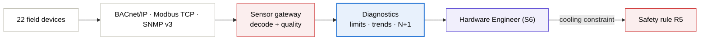

# Hardware layer

[Architecture index](README.md)

| Part | Code | What it does |
|---|---|---|
| Registry | `hardware/registry.py` | 2 CRAH (BACnet/IP), chiller, duty + standby pumps, cooling tower, 3 room sensors (Modbus TCP), UPS (SNMP v3, RFC 1628 UPS-MIB), 12 rack PDUs (SNMP v3). Each point: address, encoding, scale, valid range |
| Gateway | `hardware/gateway.py` | Encodes values the way each protocol carries them, decodes with the point map, flags `out_of_range` (impossible or saturated), `no_data`, `comm_loss`. Read-only. A real BACnet/Modbus/SNMP client can replace `SimulatedFieldBus` behind the same `read()` |
| Diagnostics | `hardware/diagnostics.py` | Limits with sources (ISO 10816-1 vibration, ASHRAE humidity, filter final ΔP, condenser approach, containment pressure, UPS); straight-line trend of daily means → days to the next limit (only when r² ≥ 0.8); N+1: one CRAH must carry the week's peak IT load; humidity sensors cross-checked against the CRAH return-air dew point |
| Constraint | same | Advisory → `none`; cooling-path warning → `no_raise`; cooling-path failure with no healthy backup → `fallback` (a critical pump with a ready standby stays `no_raise`) |
| Catalog | `hardware/catalog.py` | Installed model of every device and instrument with the vendor facts used and their source (see the README's Sources) |

Faults in the test weeks are flagged 2–6 days before their warning limit (filter, bearing, condenser, humidity drift);
checked every 6 hours from 9 Feb to 14 Apr, the healthy weeks raise no alarm. Example: at 29 Apr 05:30 the MPC wants 21 °C
after the GPU batch, the Hardware Engineer reports lost N+1 and a worn bearing, and R5 keeps 20 °C.
